# 🌌 Portfólio Guilherme Valadares 👨‍💻

> [!NOTE]
> Portfólio profissional em forma de viagem pelo universo: cada parte da minha trajetória é um lugar da galáxia, e a rolagem da página leva a câmera até ele.

<table>
  <tr>
    <td width="800px">
      <div align="justify">
        Este é o meu <b>portfólio profissional</b>, feito para o trabalho de <i>Desenvolvimento e Integração de Aplicações Web</i> do curso de <b>Engenharia de Software da PUC Minas</b>. Ele apresenta quem eu sou, meus <b>projetos em linha do tempo</b>, minhas <b>experiências</b> e as formas de <b>contato</b>, com a identidade visual da <a href="https://auereastack.com.br/">Aurea</a>, a empresa que eu fundei. Ao entrar, a tela liga como um monitor antigo e aparece uma galáxia em 3D. Rolando a página, você viaja por ela: passa pelo planeta de onde eu saí, por um planeta para cada projeto, por uma constelação com as experiências e termina no buraco negro do centro, onde fica o formulário de contato.
      </div>
    </td>
    <td>
      <div>
        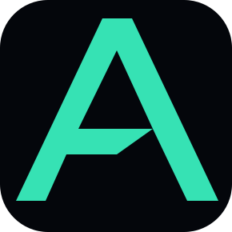
      </div>
    </td>
  </tr>
</table>

---

## 🚧 Status do Projeto

[](https://github.com/guilhermevaladares7/portfolio/actions/workflows/deploy.yml)


---

## 📚 Índice
- [Links Úteis](#-links-úteis)
- [Sobre o Projeto](#-sobre-o-projeto)
- [Funcionalidades Principais](#-funcionalidades-principais)
- [Tecnologias Utilizadas](#-tecnologias-utilizadas)
  - [Dependências](#-dependências)
- [Arquitetura](#-arquitetura)
- [Instalação e Execução](#-instalação-e-execução)
  - [Pré-requisitos](#pré-requisitos)
  - [Variáveis de Ambiente](#-variáveis-de-ambiente)
  - [Instalação de Dependências](#-instalação-de-dependências)
  - [Como Executar a Aplicação](#-como-executar-a-aplicação)
- [Deploy](#-deploy)
- [Estrutura de Pastas](#-estrutura-de-pastas)
- [Demonstração](#-demonstração)
- [Testes](#-testes)
- [Documentações utilizadas](#-documentações-utilizadas)
- [Autor](#-autor)
- [Contribuição](#-contribuição)
- [Agradecimentos](#-agradecimentos)
- [Licença](#-licença)

---

## 🔗 Links Úteis
* 🌐 **Site publicado:** [guilhermevaladares7.github.io/portfolio](https://guilhermevaladares7.github.io/portfolio/)
  > 💻 Hospedado de graça no **GitHub Pages**, publicado automaticamente pelo GitHub Actions a cada push na `main`.
* 🏢 **Aurea:** [auereastack.com.br](https://auereastack.com.br/)
  > A empresa de sites, sistemas e automações com IA que eu fundei. O portfólio usa as cores, as fontes, o logo e o mascote dela.

---

## 📝 Sobre o Projeto

O objetivo é apresentar a minha trajetória, minhas habilidades, meus projetos e as formas de falar comigo de um jeito moderno e acessível, que fique na memória de quem visita.

- **Por que existe:** é o trabalho de portfólio da disciplina e também a minha vitrine profissional, para clientes da Aurea e para vagas.
- **O que resolve:** junta num lugar só o que hoje está espalhado entre GitHub, LinkedIn, Instagram e o site da Aurea, com os projetos em ordem cronológica e com GIFs deles funcionando.
- **Contexto:** acadêmico (PUC Minas) e profissional (Aurea).
- **A ideia:** em vez de uma página comum com seções empilhadas, o site é uma viagem. A rolagem controla uma câmera em 3D, e cada seção do menu é um lugar do universo:

| Seção | Lugar no universo |
| :--- | :--- |
| Início | Vista da galáxia inteira, logo depois da tela ligar |
| Sobre mim | O planeta verde-água, a "terra natal" |
| Projetos | Um planeta para cada projeto, do mais antigo (na borda da galáxia) ao mais novo (perto do centro) |
| Experiências | Uma constelação que se desenha conforme a rolagem |
| Contato | O buraco negro no centro da galáxia |

---

## ✨ Funcionalidades Principais

- 📺 **Abertura com a tela ligando:** a linha branca de um monitor CRT se abre e a câmera chega voando até a galáxia.
- 🌌 **Universo em 3D guiado pela rolagem:** galáxia espiral com 70 mil partículas, planetas com superfície procedural, constelação e buraco negro com disco de acreção, todos em shaders próprios.
- 🪐 **Planetas clicáveis:** clicar num planeta leva até o projeto dele. Passar o mouse destaca o projeto na linha do tempo.
- 🗂️ **Linha do tempo dos projetos:** oito projetos em ordem cronológica, cada um com nome, descrição, tecnologias, link do GitHub, link do site no ar (quando existe) e um GIF dele funcionando.
- 💼 **Experiências organizadas:** empresa ou instituição, cargo ou atividade, período e descrição de cada etapa.
- 🌐 **Português e inglês:** o site inteiro troca de idioma, e o "Sobre mim" tem a troca em destaque com efeito de decodificação. A escolha fica salva no navegador.
- 📨 **Formulário de contato com envio por e-mail:** nome, e-mail e mensagem, com validação, enviado pelo **EmailJS**. Sem as chaves configuradas, ele abre o app de e-mail com a mensagem pronta.
- 🔗 **Ícones de contato:** e-mail, WhatsApp, LinkedIn, Instagram, GitHub e o site da Aurea.
- 🧭 **Navegação sempre à mão:** menu fixo no topo, menu em tela cheia no celular e uma trilha lateral que mostra em que ponto da viagem você está.
- 👾 **Auri, o mascote da Aurea:** vestido de astronauta, ele guia a viagem e fala quando você clica nele.
- 📱 **Responsivo e acessível:** layout próprio para celular, 3D mais leve em telas pequenas, versão sem animações para quem ativa "reduzir movimento" e fundo alternativo se o navegador não tiver WebGL.

---

## 🛠 Tecnologias Utilizadas

### 💻 Front-end

* **Biblioteca:** React 19
* **Linguagem:** TypeScript
* **Build Tool:** Vite 8
* **Estilização:** Tailwind CSS 4
* **3D:** Three.js com React Three Fiber
* **Animações:** Framer Motion
* **Formulário:** React Hook Form
* **Envio de e-mail:** EmailJS
* **Estado:** Context API (idioma) e um objeto compartilhado entre a rolagem e a cena 3D
* **Fontes:** Archivo (largura variável, a mesma da Aurea) e Pixelify Sans

### ⚙️ Infraestrutura & DevOps

* **Hospedagem:** GitHub Pages (gratuita)
* **CI/CD:** GitHub Actions, com build e deploy a cada push na `main`
* **Qualidade:** checagem de tipos com `tsc` e lint com Oxlint

### 📦 Dependências

| Pacote | Versão | Para que serve |
| :--- | :--- | :--- |
| `react` / `react-dom` | 19.3 | Interface |
| `three` | 0.187 | Motor 3D (WebGL) |
| `@react-three/fiber` | 9.8 | Three.js escrito como componentes React |
| `framer-motion` | 14.14 | Animações de entrada, troca de projeto e menu |
| `react-hook-form` | 7.92 | Estado e validação do formulário |
| `@emailjs/browser` | 5.0 | Envio do formulário por e-mail direto do front-end |
| `tailwindcss` / `@tailwindcss/vite` | 4.3 | Estilos utilitários |
| `vite` / `@vitejs/plugin-react` | 8.3 / 6.1 | Servidor de desenvolvimento e build |
| `typescript` | 7.0 | Tipagem |
| `oxlint` | 1.90 | Lint |
| `@types/three`, `@types/react`, `@types/react-dom`, `@types/node` | — | Tipos para o TypeScript |

---

## 🏗 Arquitetura

É uma **SPA estática**: não tem back-end próprio. O build gera HTML, CSS, JS e os GIFs, que o GitHub Pages serve. O único serviço externo é o EmailJS, chamado direto do navegador.

A página tem duas camadas, uma em cima da outra:

1. **Cena 3D** (`src/scene`), num `<canvas>` fixo que ocupa a tela toda, atrás de tudo.
2. **Conteúdo HTML** (`src/sections`), que rola por cima e continua sendo texto de verdade: dá para ler, selecionar, navegar pelo teclado e ser lido por leitores de tela.

As duas conversam por um objeto pequeno, o `journey`:

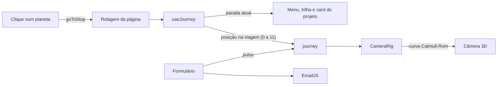

- **Paradas:** cada seção marca no HTML o ponto em que a câmera deve estar parada (`data-stop`). O hook `useJourney` mede essas posições e transforma a rolagem num número contínuo, de 0 (início) a 11 (contato).
- **Câmera:** o `CameraRig` passa esse número por curvas Catmull-Rom com as posições e os alvos de cada parada (`layout.ts`). Ele segura a câmera parada no começo e no fim de cada trecho, para dar tempo de ler, e suaviza o movimento. Em telas estreitas usa outros alvos, para o planeta aparecer acima do texto.
- **Desempenho:** as partículas são geradas uma vez, com um gerador de números com semente (a galáxia sai igual em toda visita). O movimento delas é calculado na GPU, nos shaders. O Three.js fica num pedaço separado do código, carregado depois do texto (`React.lazy`).
- **Dados separados da interface:** perfil, projetos, experiências e todos os textos ficam em `src/data`, em português e inglês. Para adicionar um projeto basta incluir um item em `projects.ts`: o planeta, a parada da câmera e o ponto na linha do tempo aparecem sozinhos.

---

## 🔧 Instalação e Execução

### Pré-requisitos

* **Node.js:** 20 ou superior (usei o 24)
* **npm:** 10 ou superior
* Um navegador com **WebGL** (Chrome, Edge, Firefox ou Safari atuais)

### 🔑 Variáveis de Ambiente

O formulário envia e-mail pelo [EmailJS](https://www.emailjs.com/). Copie o arquivo de exemplo:

```bash
cp .env.example .env
```

E preencha com os dados da sua conta do EmailJS:

| Variável | Onde achar no EmailJS |
| :--- | :--- |
| `VITE_EMAILJS_SERVICE_ID` | Email Services → o serviço conectado ao seu e-mail |
| `VITE_EMAILJS_TEMPLATE_ID` | Email Templates → o template da mensagem |
| `VITE_EMAILJS_PUBLIC_KEY` | Account → General → Public Key |

O template recebe os campos `name`, `email`, `message` e `title` (também vão `from_name` e `reply_to`, para templates antigos).

> [!TIP]
> Sem essas variáveis o site funciona normalmente: o botão "Enviar sinal" abre o app de e-mail de quem visita, com a mensagem já escrita.

No deploy, as mesmas três variáveis ficam em **Settings → Secrets and variables → Actions** do repositório, com os mesmos nomes.

### 📦 Instalação de Dependências

```bash
git clone https://github.com/guilhermevaladares7/portfolio.git
cd portfolio
npm install
```

### ⚡ Como Executar a Aplicação

Ambiente de desenvolvimento, em [http://localhost:5173](http://localhost:5173):

```bash
npm run dev
```

Build de produção e prévia local do resultado:

```bash
npm run build
npm run preview
```

Checagem de código:

```bash
npm run lint
```

---

## 🚀 Deploy

O deploy é automático. A cada push na `main`, o workflow [`.github/workflows/deploy.yml`](.github/workflows/deploy.yml):

1. instala as dependências com `npm ci`;
2. roda `npm run build` com o caminho do repositório (`/portfolio/`) e as chaves do EmailJS que estão nos secrets;
3. publica a pasta `dist` no GitHub Pages.

Para ativar num fork: **Settings → Pages → Source: GitHub Actions**.

---

## 📂 Estrutura de Pastas

```
.
├── .github/workflows/deploy.yml   # 🤖 Build e deploy no GitHub Pages
├── .env.example                   # 🧩 Variáveis do EmailJS (sem valores)
├── docs/                          # 🖼️ Logo e capturas de tela usadas neste README
├── public/
│   ├── favicon.svg                # ⭐ Ícone da aba, o A da Aurea
│   └── projetos/                  # 🎞️ GIFs dos projetos funcionando
├── src/
│   ├── main.tsx                   # 🚪 Ponto de entrada
│   ├── App.tsx                    # 🧱 Junta o universo, a abertura, o menu e as seções
│   ├── i18n.tsx                   # 🌐 Idioma atual (português ou inglês)
│   ├── index.css                  # 🎨 Tailwind, cores e fontes da Aurea
│   ├── components/                # 🧩 Abertura, menu, trilha, logo, ícones e o Auri
│   ├── data/                      # 📄 Perfil, projetos, experiências e textos da interface
│   ├── hooks/useJourney.ts        # 🧭 Transforma a rolagem na posição da viagem
│   ├── lib/                       # 🔧 Envio do formulário, seções do menu e utilitários
│   ├── scene/                     # 🌌 Cena 3D: galáxia, estrelas, planetas, constelação,
│   │                              #    buraco negro, câmera e posições de cada parada
│   └── sections/                  # 📑 Início, Sobre mim, Projetos, Experiências e Contato
├── index.html
├── package.json
├── tsconfig.json
├── vite.config.ts
├── LICENSE
└── README.md
```

---

## 🎥 Demonstração

### 🌐 Computador

| Início | Sobre mim |
| :---: | :---: |
| 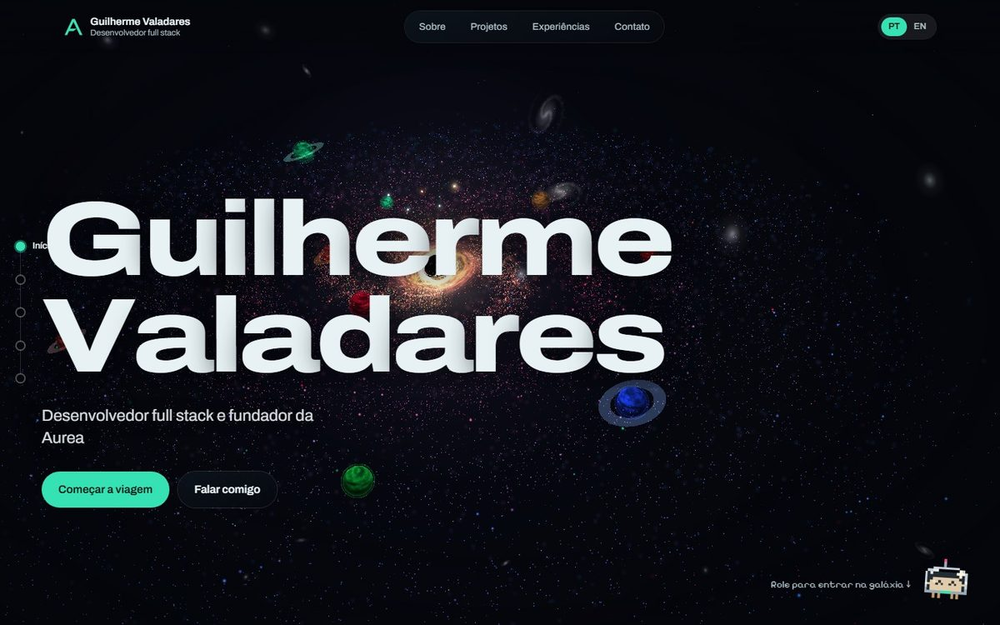 | 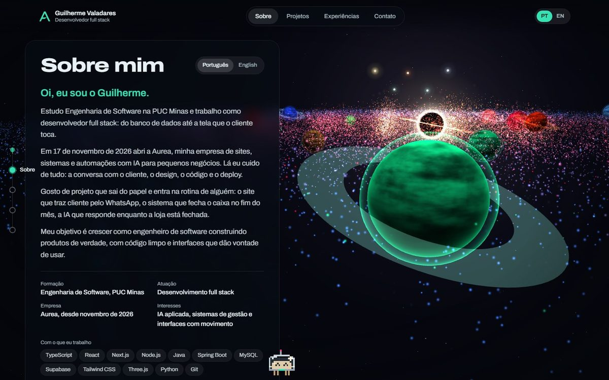 |
| **Projetos** | **Experiências** |
| 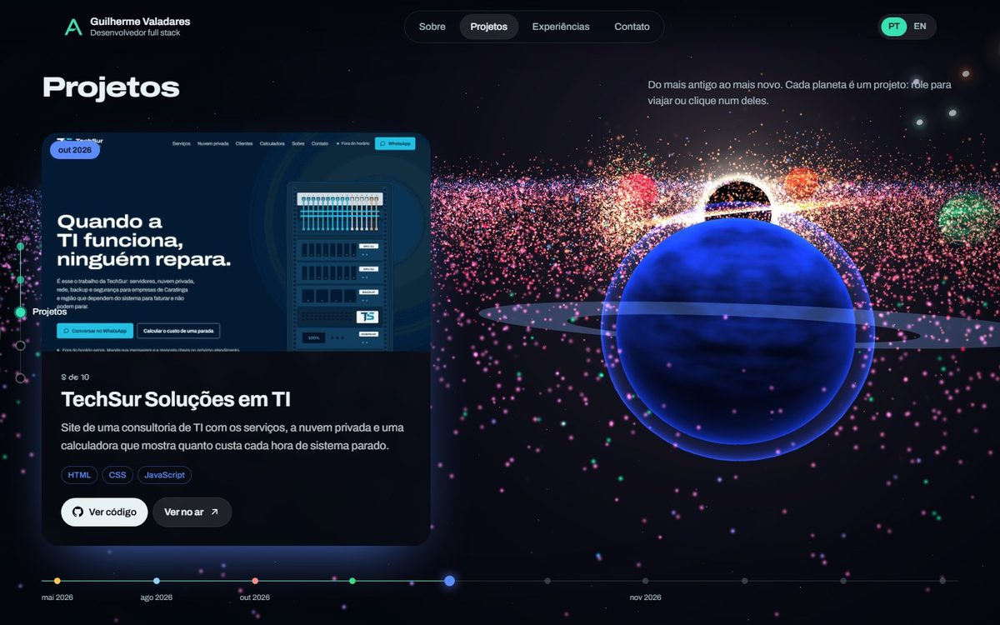 | 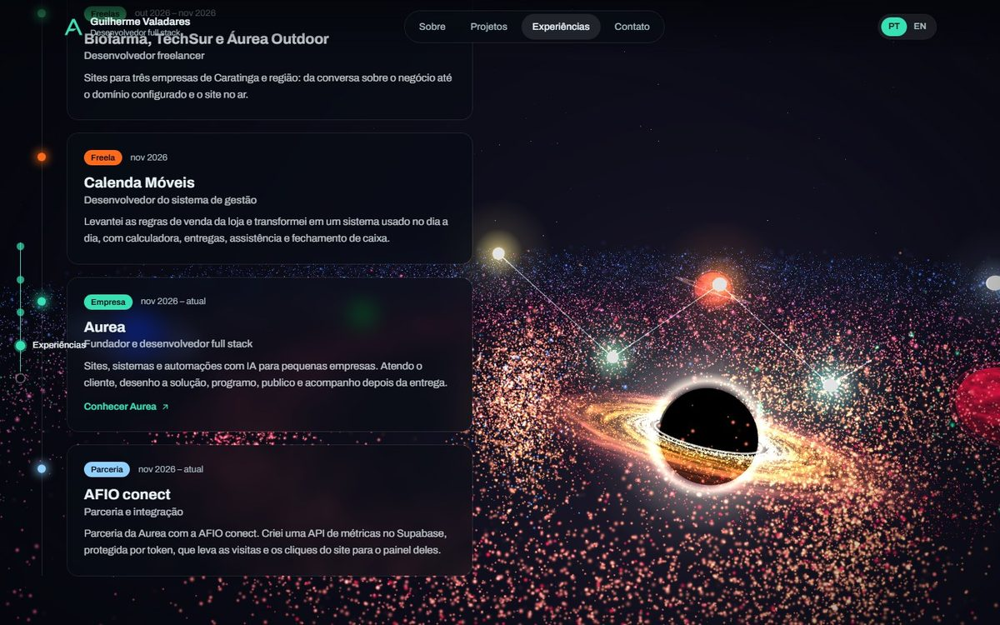 |
| **Contato** | |
| 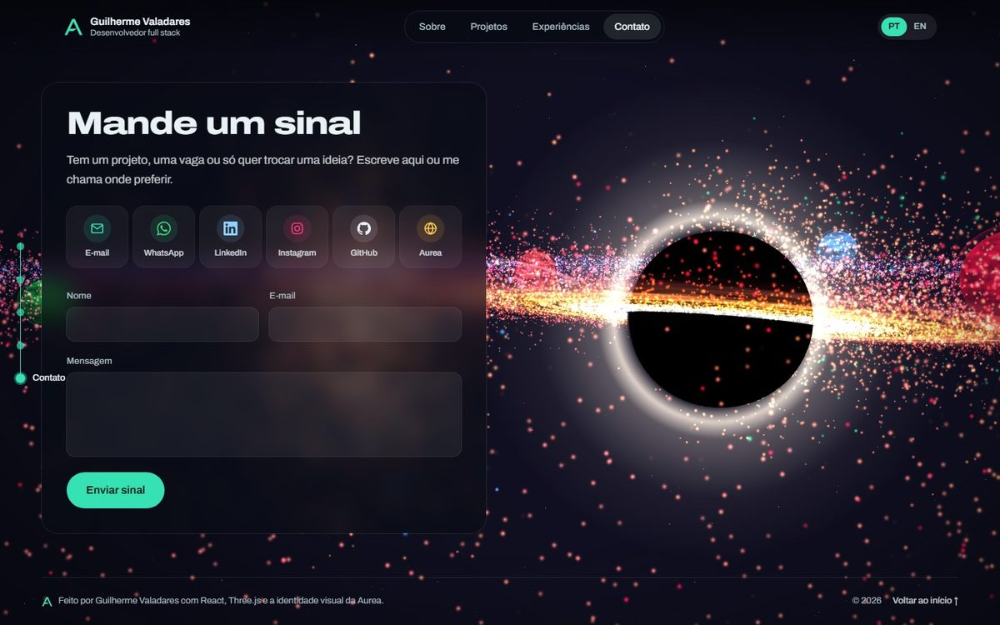 | |

### 📱 Celular

| Início | Sobre mim | Projetos | Contato |
| :---: | :---: | :---: | :---: |
| 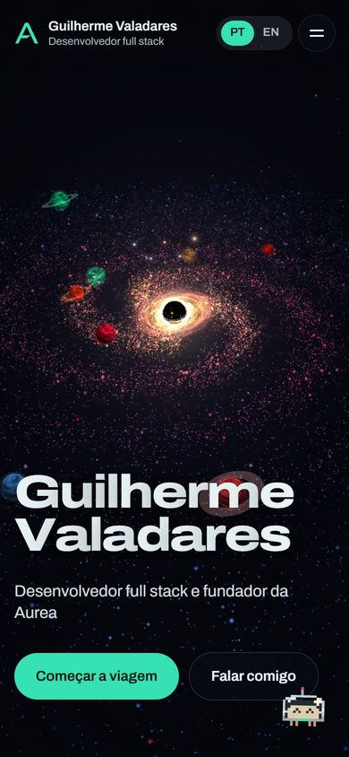 | 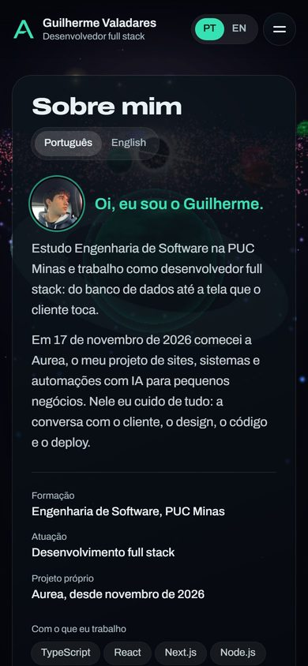 | 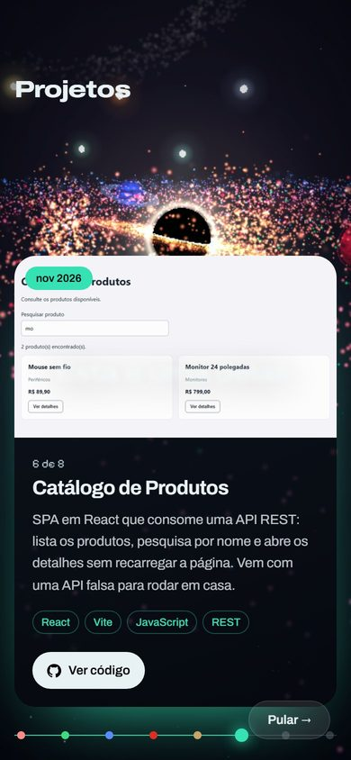 | 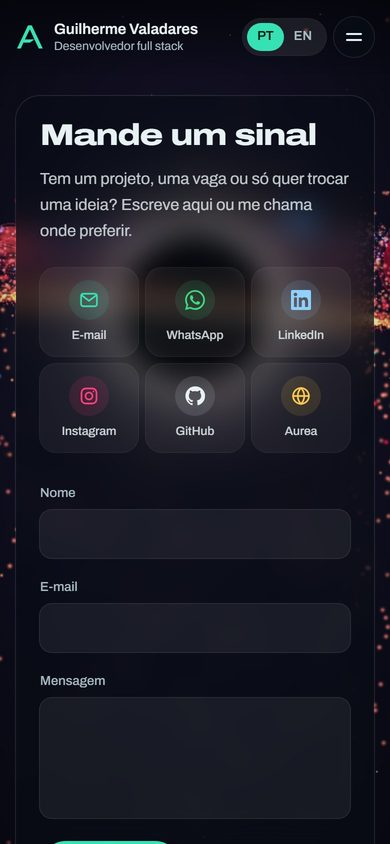 |

### 🎞️ GIFs dos projetos

Gravados com os projetos rodando: os sites no ar, e os demais rodando localmente a partir dos repositórios, e o do Calenda a partir de uma gravação de tela do sistema.

| Site da Aurea | Calenda |
| :---: | :---: |
| 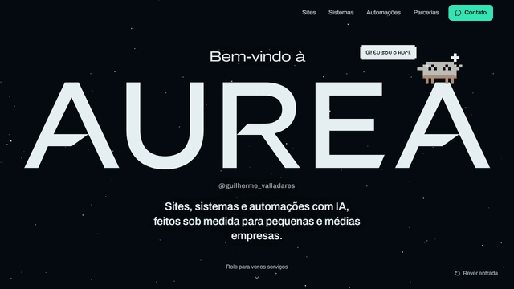 | 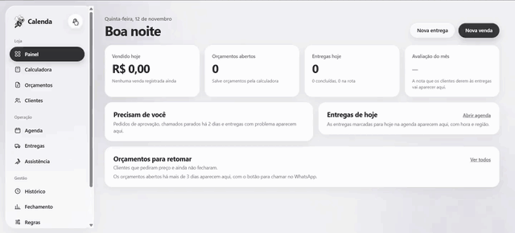 |
| **Sistema de Informação Hospitalar** | **Catálogo de Produtos** |
| 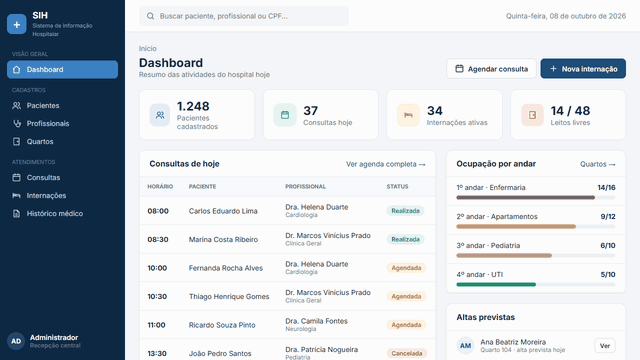 | 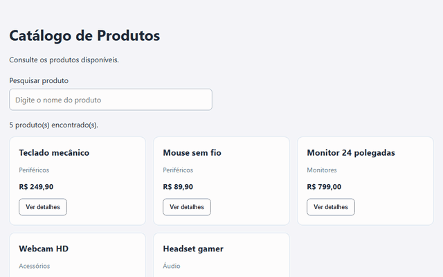 |

---

## 🧪 Testes

O projeto não tem testes automatizados: é uma página de apresentação, sem regra de negócio. A verificação foi feita assim:

- `tsc` sem erros de tipo e `oxlint` sem erros a cada mudança;
- build de produção com o caminho do GitHub Pages;
- navegação completa em tela de computador (1440 × 900) e de celular (390 × 844), conferindo cada parada da câmera;
- validação do formulário: nome com menos de 2 letras, e-mail inválido e mensagem com menos de 10 ou mais de 2000 caracteres.

---

## 🔗 Documentações utilizadas

* 📖 [React](https://react.dev/reference/react)
* 📖 [Vite](https://vite.dev/config/)
* 📖 [Three.js](https://threejs.org/docs/)
* 📖 [React Three Fiber](https://r3f.docs.pmnd.rs/)
* 📖 [Framer Motion](https://motion.dev/docs/react)
* 📖 [Tailwind CSS](https://tailwindcss.com/docs)
* 📖 [React Hook Form](https://react-hook-form.com/docs)
* 📖 [EmailJS](https://www.emailjs.com/docs/sdk/send/)
* 📖 [GitHub Pages com Actions](https://docs.github.com/pt/pages/getting-started-with-github-pages/using-custom-workflows-with-github-pages)

---

## 👤 Autor

| 👤 Nome | :octocat: GitHub | 💼 LinkedIn | 📤 Gmail |
|---------|-----------------|-------------|-----------|
| Guilherme Ferreira Valadares | <div align="center"><a href="https://github.com/guilhermevaladares7"></a></div> | <div align="center"><a href="https://www.linkedin.com/in/guilherme-ferreira-valadares-43009640b/"></a></div> | <div align="center"><a href="mailto:glhrmvaladares@gmail.com"></a></div> |

---

## 🤝 Contribuição

1. Faça um `fork` do projeto.
2. Crie uma branch (`git checkout -b feature/minha-feature`).
3. Faça o commit das mudanças (`git commit -m 'feat: descreve a mudança'`).
4. Envie a branch (`git push origin feature/minha-feature`).
5. Abra um **Pull Request**.

---

## 🙏 Agradecimentos

* [**Engenharia de Software PUC Minas**](https://www.instagram.com/engsoftwarepucminas/) - Pela estrutura do curso e pelos trabalhos que viraram projetos deste portfólio.
* [**Prof. Dr. João Paulo Aramuni**](https://github.com/joaopauloaramuni) - Pela proposta do trabalho e pelo template deste README.

---

## 📄 Licença

Este projeto é distribuído sob a **[Licença MIT](LICENSE)**.
